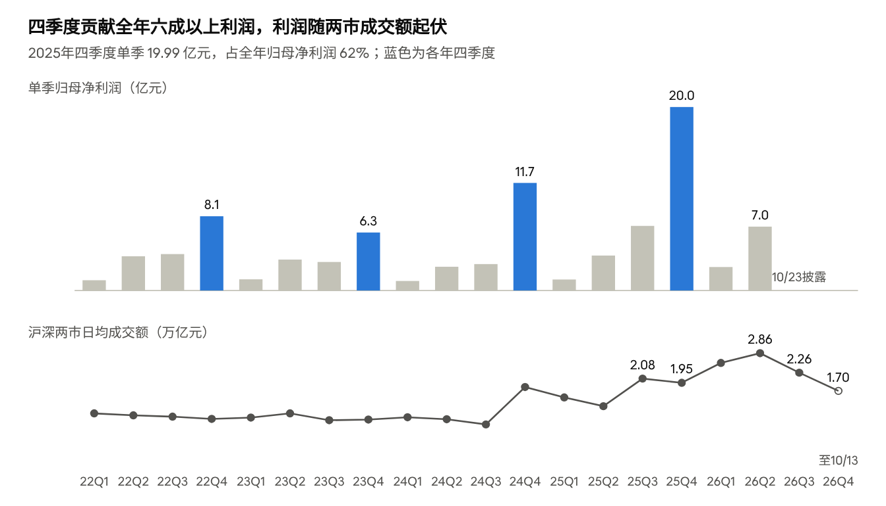
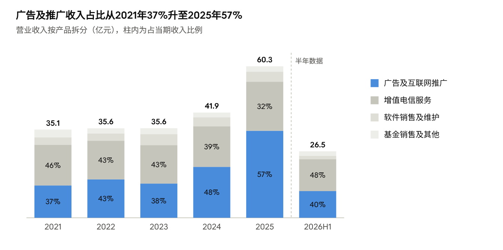
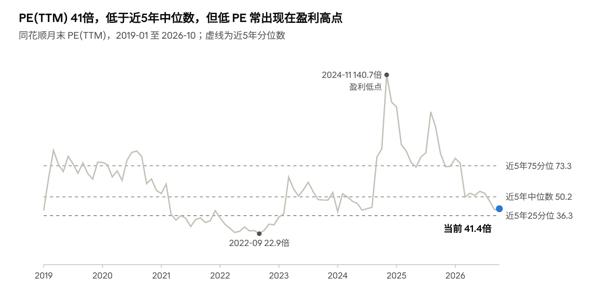
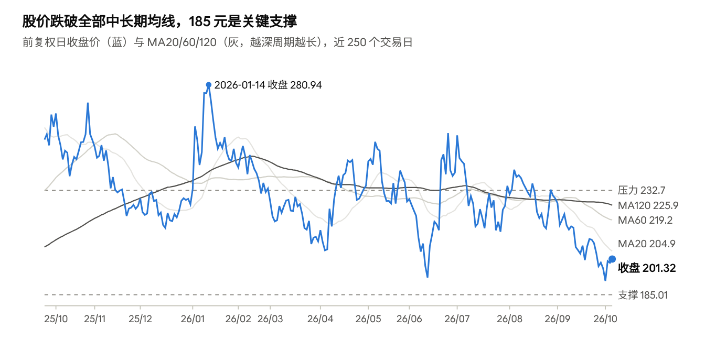
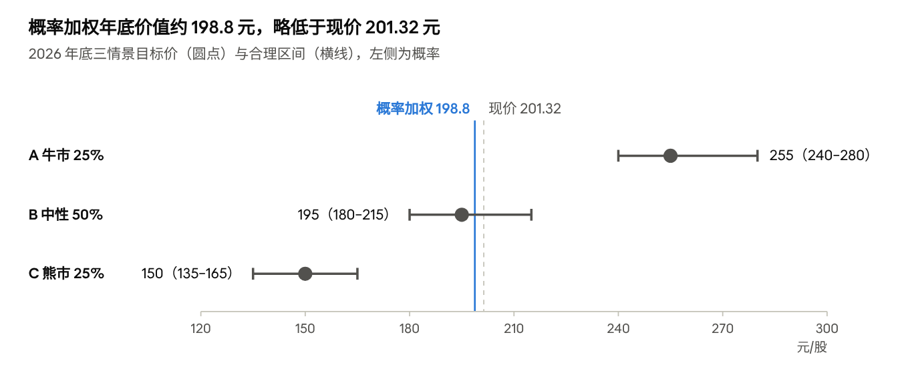

# 同花顺（300033）投委会研究报告：2026年底走势预测

2026-10-13 · Xiaofan Liu

## 核心结论

**中性（持有，不追高）。2026 年底中性目标区间 180–215 元，概率加权价值 198.8 元，较现价 201.32 元低 1.3%；上涨概率约 40%，熊市情景看 150 元（-25%）。置信度 50/100。**

- **高增已经兑现，接下来看四季度。** 2026 上半年归母 +89.8%，但近两年 62%–64% 的利润在四季度。9 月以来两市成交（10 月日均 1.70 万亿元，较 5 月 -47%）和新开户（9 月同比 -35%）明显降温。中性情景 2026E 归母 34.9 亿元（+9%），比 16 家机构均值 42.70 亿元低约 18%。
- **监管是新变量。** 9 月 30 日施行的《金融产品网络营销管理办法》及地方证监局要求付费“不得与开户量挂钩”，直接触及卖方所说的“买断制开户”广告模式（广告占 2025 年收入 57%）。影响主要落在 2027 年，但会压制估值。
- **估值不贵也不便宜。** PE(TTM) 41.4 倍处于近 3 年第 10 百分位，但这是盈利高点的低 PE。按历年年末对下一年利润 34–48 倍的区间，中性价值约 195 元。
- **技术面中期偏空、短线企稳。** 股价低于 MA60/120/250，185 元是关键支撑，219 元和 232 元是压力。
- **持仓者：** 225–233 元减仓 1/3；183–186 元、172–176 元分批加仓；周收盘跌破 168 元止损。
- **最重要的两个验证点：** 10 月 19–22 日金融街论坛的政策，以及 10 月 23 日三季报的合同负债（≥ 35 亿元偏强，< 30 亿元偏弱）。

## 数据来源与信息缺口

全部数据截至 2026-10-13 收盘，由原始接口与公告原文重新计算，未直接引用二手结论。股价统一用前复权口径（2026-04-10 除权：每10股转增4股并派51元），现总股本 7.5264 亿股。

| 类别 | 来源 | 覆盖范围 |
| --- | --- | --- |
| 行情、指数、资金流 | 东方财富行情接口 | 300033 日/周/月K，9个A股指数，近120日主力资金，个股融资余额 |
| 财务报表 | 东方财富数据中心三张表，与巨潮年报原文核对 | 2018 年至 2026 年半年报 |
| 公告 | [巨潮资讯](http://www.cninfo.com.cn/new/disclosure/stock?stockCode=300033&orgId=9900008416)，71 份（2025-07 至今），2020–2025 年报全文 | 分红、减持、业绩预告、限售解禁 |
| 卖方预测 | 同花顺一致预期（16家），东方财富研报库 | 2026–2028E |
| 宏观与海外 | 中美国债收益率、LPR、USD/CNH、美元指数、美股与港股指数 | 2024 年至今 |
| 新闻与情绪 | 东方财富资讯 296 条，股吧 640 帖（9/22–10/13） | 情绪为标题关键词粗分类 |

**信息缺口（会影响结论的可靠性）：**

- **付费用户数、付费率、ARPU：公司从未披露。** 2023 年报是最后一次披露活跃用户（日均 1,447 万、周活 1,936 万），2024 年报起停止。唯一的新数据是第三方口径：易观千帆称 2026 年 6 月同花顺 App 月活约 3,853 万，转引自[东吴证券 8/22 点评](https://pdf.dfcfw.com/pdf/H3_AP202608221828331655_1.pdf)。
- **AI 业务收入未单独披露，** 无法验证 AI 的实际变现。
- **广告收入的客户结构与计费方式未披露。** 按开户计费（买断制）的占比是评估新规冲击的关键，目前只能推断。
- **2026 年三季报 10 月 23 日披露，** 本报告未包含，届时需复核。
- 北向资金自 2024 年 8 月起不再按日披露，只有季度十大股东数据。
- 卖方 EPS 预测混用转增前后的股本，本文统一用归母净利润口径。

## 公司基本面

同花顺盈利能力很强，但利润高度依赖 A 股交投活跃度。2025 年归母净利润 32.05 亿元（+75.8%），2026 年上半年 9.52 亿元（+89.8%），但 2024–2025 年利润的 62%–64% 集中在四季度。毛利率常年 89%–92%，经营现金流持续高于净利润，没有有息负债。

### 近五年财务（亿元）

| 指标 | 2021 | 2022 | 2023 | 2024 | 2025 | 2026H1 |
| --- | --- | --- | --- | --- | --- | --- |
| 营业收入 | 35.10 | 35.59 | 35.64 | 41.87 | 60.29 | 26.46 |
| 收入同比 | +23.4% | +1.4% | +0.1% | +17.5% | +44.0% | +48.7% |
| 归母净利润 | 19.11 | 16.91 | 14.02 | 18.23 | 32.05 | 9.52 |
| 归母同比 | +10.9% | -11.5% | -17.1% | +30.0% | +75.8% | +89.8% |
| 扣非归母 | 18.86 | 16.16 | 13.69 | 17.65 | 30.51 | 9.34 |
| 毛利率 | 91.4% | 89.6% | 89.1% | 89.4% | 91.5% | 89.0% |
| 净利率 | 54.5% | 47.5% | 39.3% | 43.5% | 53.2% | 36.0% |
| 加权 ROE | 33.6% | 25.6% | 20.2% | 24.8% | 38.5% | 10.5%（半年） |
| 经营现金流净额 | 21.28 | 17.50 | 15.92 | 23.16 | 37.74 | 22.19 |
| 经营现金流/归母 | 1.11 | 1.03 | 1.14 | 1.27 | 1.18 | 2.33 |
| 合同负债（期末预收） | 10.44 | 9.82 | 11.02 | 14.86 | 17.69 | 33.53 |
| 研发费用 | 8.28 | 10.67 | 11.79 | 11.93 | 11.45 | 6.59 |
| 研发/收入 | 23.6% | 30.0% | 33.1% | 28.5% | 19.0% | 24.9% |
| 销售费用 | 3.37 | 3.68 | 4.97 | 5.92 | 7.59 | 5.87 |

来源：东方财富数据中心三张表，与 [2025 年报](http://static.cninfo.com.cn/finalpage/2026-03-10/1225002186.PDF)、[2026 半年报](http://static.cninfo.com.cn/finalpage/2026-08-22/1225491733.PDF) 原文核对。

### 利润结构：广告业务与四季度

*图源：公司定期报告（东方财富数据中心）；两市成交额为上证指数+深证综指成交额日均 · 2022Q1–2026Q4（26Q4 至 10/13）*

*图源：公司年报/半年报主营构成 · 2021–2026H1*

- **广告收入大部分在下半年确认：** 2022–2025 年下半年占全年广告收入的 77%–83%。
- **下半年广告收入与两市成交额高度绑定：** 下半年广告收入（亿元）除以下半年两市日均成交额（万亿元），2022–2025 年分别为 13.7、12.8、13.6、14.0。这是本报告盈利模型的核心依据。
- **广告变现效率在下降：** 2026 上半年同一比值为 3.9，低于 2025 年上半年的 4.7。广告收入 +65.8%，跑输成交额约 +100% 的增速。
- **领先指标仍强：** 6 月末合同负债 33.53 亿元（+44.9%），上半年销售收现 44.94 亿元（+65.2%），支撑下半年增值电信收入确认。
- **成本在加速：** 上半年销售费用 +75.4%，其中广告及市场推广费 +145.4%（[开源证券 8/23 点评](https://pdf.dfcfw.com/pdf/H3_AP202608241828366015_1.pdf)）。下半年若市场降温、投放不减，利润率会受压。

### 用户、付费与 AI

- **用户：** 2021–2023 年日均使用人数 1,445 万、1,463 万、1,447 万，基本持平；2024 年起不再披露。易观千帆口径 2026 年 6 月 App 月活约 3,853 万，第三方证券服务 App 第一。
- **付费率：未披露。** 可用的替代指标是合同负债：2023 年末 11.02 亿元，2026 年 6 月末 33.53 亿元，两年半增至 3.0 倍。
- **AI 产品：** 个人端“问财”从问答工具升级为智能投研 Agent；机构端推出 iFinD MCP，把数据接入客户本地 AI 环境。AI 收入未单列。
- **反面证据：** 2025 年研发费用 11.45 亿元，同比 -4.0%；研发人员 3,141 人，仅 +1.2%；员工总数 5,087 人，比 2023 年末少 405 人。“加大 AI 投入”在 2025 年财务数据中看不到，2026 上半年研发投入才回升 13.5%。

### 股东回报与治理

- 2025 年度派现合计约 27.96 亿元，派息率约 87%，并每 10 股转增 4 股。2026 年首次实施中期分红，每 10 股派 2 元（1.51 亿元，仅为上半年利润的 15.8%）。
- 实控人易峥持股 36.13%，前五大股东合计约 64.5%（2026-06-30），实际流通盘偏小。
- 8 月 24–27 日凯士顺、于浩淼、王进合计减持 406.5 万股（0.54%），均价 222.22 元（[公告](http://static.cninfo.com.cn/finalpage/2026-08-28/1225526739.PDF)）。凯士顺 2026 年 1 月解禁后，每年可转让不超过持股的 25%，后续仍可能减持。

## 行业分析

行业景气取决于三件事：A 股交投活跃度、营销监管允许的范围、AI。2026 年上半年景气已经见顶。9 月 30 日施行的《金融产品网络营销管理办法》是未来一年最大的变量，对同花顺这类第三方平台影响偏负面。

### 未来一年趋势：高位回落

- **成交额：** 两市日均成交额 2025 年 1.70 万亿元，2026 年迄今 2.53 万亿元；但月度从 5 月的 3.18 万亿元降到 9 月 1.82 万亿元，10 月（至 13 日）1.70 万亿元。
- **新开户：** 9 月 A 股新开户 191.19 万户，同比 -34.9%，年内最低；前三季度累计 2,712.59 万户，同比约 +34.6%（[上交所数据，东方财富转载](https://finance.eastmoney.com/a/202610103891898133.html)）。
- **杠杆资金：** 融资余额从 6 月末 2.997 万亿元降到 10 月 12 日 2.525 万亿元（-15.7%）。
- 公司半年报自己也写明：用户活跃度、付费需求和机构投入“与资本市场运行状况及交投活跃度密切相关”，而且“基础行情和资讯服务日趋同质化”。

### 政策环境：营销新规是核心变量

[《金融产品网络营销管理办法》](https://www.csrc.gov.cn/csrc/c100028/c7628276/content.shtml)由人民银行等八部门联合发布，2026 年 9 月 30 日施行。与同花顺直接相关的规定如下。

| 规定 | 出处 | 对同花顺的影响 |
| --- | --- | --- |
| 第三方平台不得介入销售合同签订、适当性测评等销售环节；收费应“合理定价、质价相符” | 办法第二十条 | 平台定位被限定为技术服务加广告位 |
| 提供转接渠道的，须跳转至金融机构自营平台 | 办法第五条 | 开户、交易跳转路径需要合规化 |
| 向平台付费不得直接或间接与开户量、交易量、手续费、资金量挂钩 | 多地证监局落实要求（[财联社 10/12](http://finance.eastmoney.com/a/202610123892886175.html)） | 直接触及按开户计费的“买断制”广告模式 |
| 为证券交易提供转接渠道的平台须向证监会备案，存量合作 1 年内整改 | 同上 | 影响主要落在 2027 年 |
| 引导投资者优先使用机构自营 App | 同上 | 利好东方财富等自营平台，相对不利第三方平台 |
| 全面叫停与“大V”、MCN 的营销合作 | 办法及地方要求（[中国证券报 10/9](http://finance.eastmoney.com/a/202610093890075744.html)） | 利好：预算向持牌、合规平台集中 |

**关键不确定性：** 开源证券把 2026 上半年广告高增归因于“买断制开户模式快速推广”。如果这部分收入按开户量计价，就要改为与业务指标脱钩的定价，增长弹性会下降。公司和券商都未披露计费结构，这一影响目前无法量化。

**另一面：** 新规实施首周，同花顺出现在多家券商和基金公司公示的合作平台名单中。例如国元证券只公示了 3 家渠道平台：同花顺、大智慧、小红书（[21 世纪经济报道 10/13](http://finance.eastmoney.com/a/202610133893513497.html)）。大V退场后，营销预算可能向同花顺集中。

**其他监管与政策信号：**

- 2026 年 7 月，“同花顺股票”微信小程序因违法违规收集使用个人信息被国家网络安全通报中心通报（[蓝鲸财经](http://finance.eastmoney.com/a/202607103801674198.html)）。
- 持牌证券投顾机构自媒体违规频发，截至 10 月 12 日近一个月有 7 家被监管点名（[北京商报](http://stock.eastmoney.com/a/202610123893030912.html)），监管整体偏严。
- 2026 金融街论坛年会 10 月 19–22 日举行，潘功胜、丁向群、吴清将作主题演讲，市场预期期间集中发布金融改革政策（[界面新闻](http://stock.eastmoney.com/a/202610133894049577.html)）。这是年内最重要的正面催化窗口。

### AI 对金融软件行业的影响

- **正面：** 金融数据、用户和交易场景构成壁垒。问财 Agent 和 iFinD MCP 有助于提升付费转化和机构客单价。
- **负面：** 豆包、DeepSeek、腾讯元宝等通用大模型可以免费回答行情解读和选股问题，削弱基础付费功能的稀缺性。算力成本也在上升（上半年材料与委外研发 +97.5%）。半年报自述风险包括模型输出的事实偏差，以及信息服务与投资建议的合规边界。
- **判断：** 目前 AI 对同花顺更像防守手段，用来保住用户和付费，还不是新的利润来源。AI 收入未单列，不应单独给 AI 估值。

### 竞争比较

| 公司 | 市值（亿元） | 2025 营收 / 归母（亿元） | 2026H1 营收 / 归母同比 | PE(TTM) | PB | H1 毛利率 | 模式与近况 |
| --- | --- | --- | --- | --- | --- | --- | --- |
| 同花顺 300033 | 1,515 | 60.3 / 32.05 | +48.7% / +89.8% | 41.4 | 19.7 | 89.0% | 纯信息服务：广告导流加增值订阅 |
| 东方财富 300059 | 2,857 | 160.7 / 120.85 | +53.2% / +44.8% | 19.6 | 2.9 | 74.4% | H1 证券业务占收入 78%，自营平台，新规下相对受益 |
| 指南针 300803 | 473 | 21.5 / 2.28 | +33.8% / -12.2% | 224.8 | 14.8 | 87.1% | 信息服务加麦高证券，转型期利润薄 |
| 大智慧 601519 | 190 | 8.3 / -0.44 | +6.8% / 亏损收窄 | 亏损 | 14.7 | 64.0% | 湘财股份换股吸收合并审核中（1:1.27，[澎湃](https://www.thepaper.cn/newsDetail_forward_33175053)） |
| 财富趋势 688318 | 268 | 3.7 / 3.15 | -8.7% / -13.9% | 89.1 | 7.0 | 67.7% | 通达信，面向券商的行情交易系统 |

同花顺是纯信息服务公司中利润弹性最大、规模最大的一家。但东方财富的 PE(TTM) 只有 19.6 倍，处于其近 5 年第 0.6 百分位，说明市场已在整体下调“交易活跃度受益链”的估值。数据截至 10/13，估值为东方财富口径。

## 估值分析

当前 PE(TTM) 41.4 倍、PB 19.7 倍、PS(TTM) 22.0 倍。PE 处于近 3 年第 10 百分位、近 5 年第 34 百分位，看起来便宜。但同花顺的利润强周期，低 PE 往往出现在盈利高点，不能据此判断低估。

*图源：东方财富估值数据（月末 PE(TTM)）· 2019-01 至 2026-10-13；分位数为近5年日度数据*

2021 年中和 2022 年 PE 曾低至 23–34 倍，随后利润连续两年下滑；2024 年 11 月 PE 高达 140.7 倍，恰是利润低点、紧接着两年高增长。所以 PE 分位要和盈利周期一起看。

### 当前估值与历史分位

| 指标 | 当前 | 近 3 年分位 | 近 5 年分位 | 近 5 年中位数 |
| --- | --- | --- | --- | --- |
| PE(TTM) | 41.4 | 9.5% | 34.4% | 50.2 |
| PB(MRQ) | 19.7 | 43.1% | 65.8% | 13.3 |
| PS(TTM) | 22.0 | 28.8% | 45.9% | 22.9 |

- **前瞻估值：** 2025 静态 PE 47.3 倍；按 16 家机构一致预期，2026E 归母 42.70 亿元对应 35.5 倍，2027E 50.31 亿元对应 30.1 倍。按本报告中性情景 2026E 35 亿元，则为 43.3 倍。
- **资产负债表：** 总市值 1,515.2 亿元；6 月末货币资金 124.5 亿元（占市值 8.2%），无有息负债。2025 年度派现对应股息率约 1.8%。
- **PB 参考价值低：** 公司派息率高、净资产被持续分红压低，PB 偏高是结构性的。
- **同业：** 东方财富 PE(TTM) 19.6 倍、PS 14.5 倍；同花顺相对东方财富的 PE 溢价约 2.1 倍。其余同业利润薄或亏损，PE 可比性差。未取得海外金融数据公司的可靠可比数据。

### 年底合理估值区间

年底市场会按 2027 年盈利定价。2019–2024 年各年末市值对应下一年实际归母净利润的倍数为 34.0、34.9、46.0、37.8、46.3、48.2 倍，中位数约 42 倍。

| 情景 | 2026E 归母 | 2027E 归母 | 估值倍数 | 对应市值 | 每股价值 |
| --- | --- | --- | --- | --- | --- |
| 乐观 | 39 亿元 | 48 亿元 | 40 倍 2027E | 1,920 亿元 | 255 元 |
| 中性 | 35 亿元 | 35 亿元 | 42 倍 2026E/2027E | 1,470 亿元 | 195 元 |
| 悲观 | 29 亿元 | 24 亿元 | 39 倍 2026E（约 47 倍 2027E） | 1,130 亿元 | 150 元 |

乐观情景用 40 倍，低于历史中位数，因为盈利基数已经很高。悲观情景参照 2024 年 6–7 月底部的 PE(TTM) 40–42 倍。每股价值按总股本 7.5264 亿股计算。盈利假设见后文情景预测模型。

## 技术面分析

中期下降趋势未改，短线超跌后出现企稳迹象。收盘价 201.32 元，低于 MA20（204.9）、MA60（219.2）、MA120（225.9）和 MA250（231.8）；10 月 9 日盘中触及 185.01 元后放量收回。较 1 月 14 日盘中高点 306.87 元（前复权）回撤 34%，年初至今 -11.0%。

*图源：东方财富前复权日K，均线为本报告计算 · 2025-09-24 至 2026-10-13*

### 指标读数（10/13 收盘）

| 指标 | 日线 | 周线 | 解读 |
| --- | --- | --- | --- |
| 均线 | MA5 197.9、MA10 201.0、MA20 204.9、MA60 219.2、MA120 225.9 | MA5 202.0、MA10 212.1、MA20 218.6、MA60 232.7 | 日线、周线均空头排列；周线 MA60 是中期多空分界 |
| MACD(12,26,9) | DIF -5.80、DEA -5.90、柱 +0.20 | DIF -7.20、DEA -4.44、柱 -5.53 | 日线零轴下方金叉，属弱势反弹信号；周线死叉且在零轴下 |
| RSI | RSI6 49.5、RSI14 43.2 | RSI14 41.5 | 已离开超卖区（10/8 RSI6 20.8），未进入强势区 |
| KDJ(9,3,3) | K 44.0、D 32.8、J 66.5 | K 22.2、D 21.2 | 日线金叉；周线低位钝化 |
| 布林带(20,2) | 上轨 217.8、中轨 204.9、下轨 192.1 | 上轨 247.4、下轨 189.8 | 价格在中轨下方 |
| ATR(14) | 7.00 元（约 3.5%） | 18.5 元 | 日内波动约 ±3.5% |

### 成交量与主力资金

- **缩量：** 近 20 日日均成交 16.1 亿元、换手 1.80%，约为近 250 日均值（33.3 亿元、3.32%）的一半。10 月 9 日成交 25.6 亿元、收涨 4.77%，是 3 周内最大量，形成长下影阳线。
- **主力资金（东方财富口径，超大单+大单）：** 近 120 个交易日净流出 72.98 亿元，同期小单净流入 56.67 亿元。近 60 日 -40.09 亿元，近 20 日 -13.49 亿元，近 5 日 -2.83 亿元。最近 3 日接近平衡（-0.03、-0.21、+0.19 亿元），流出在减速，但未转为持续流入。
- **融资余额：** 10 月 12 日 56.19 亿元，与 6 月末 56.99 亿元基本持平。杠杆多头尚未去化，若跌破支撑可能引发被动卖压。

### 支撑与压力

| 类型 | 价位（元） | 依据 |
| --- | --- | --- |
| 压力 4 | 265–269 | 2026 年 6–7 月高点 265.68、268.94 |
| 压力 3 | 231.8–233.7 | MA250 231.8、周线 MA60 232.7、9/1 高点 233.65；也是近 250 日成交最密集的 220–235 元区间（约 2,764 亿元）上沿 |
| 压力 2 | 219–226 | MA60 219.2、MA120 225.9 |
| 压力 1 | 205–213 | 10/13 高点 205.5、MA20 204.9、9/22 高点 212.94 |
| 支撑 1 | 190–192 | 10/8 低点 190.02、日线布林下轨 192.1、周线布林下轨 189.8 |
| 支撑 2 | 185 | 10/9 盘中低点 185.01，为 52 周低点 |
| 支撑 3 | 172 | 2025 年 5 月低点 172.06 |
| 支撑 4 | 162 | 2025 年 4 月低点 161.80 |

### 技术面判断

- **中期：** 周线空头排列。放量（单日成交 ≥ 35 亿元）收复 MA60（约 219 元）才算中期止跌，站上 232 元才算趋势反转。
- **短线：** 185–192 元形成支撑，日线 MACD、KDJ 低位金叉，有向 205–213 元反抽的条件。跌破 185 元，下一支撑在 172 元。
- **统计参照：** 近 5 年任意 55 个交易日（约等于到年底的时长）收益的中位数为 -0.9%，10% 与 90% 分位为 -19.0% 与 +47.8%。年化波动率近 60 日 38%、近 250 日 46%。

## 市场情绪

情绪偏冷，但还不是恐慌。卖方仍一致“买入”，预测停留在 8 月；散户在接机构的卖盘，股吧以抱怨为主；AI 应用和金融街论坛是短线催化。

### 近期关键新闻

| 日期 | 来源 | 事件 | 对股价的含义 |
| --- | --- | --- | --- |
| 10/13 | [21 世纪经济报道](http://finance.eastmoney.com/a/202610133893513497.html) | 新规后券商获客转向行情工具和泛内容平台，同花顺仍在主流合作名单 | 中性偏正面 |
| 10/12 | [财联社](http://finance.eastmoney.com/a/202610123892886175.html) | 多地证监局落实新规七项要求，付费不得与开户量挂钩 | 负面（计费模式） |
| 10/10 | [上交所数据](https://finance.eastmoney.com/a/202610103891898133.html) | 9 月新开户 191.19 万户，同比 -34.9% | 负面（四季度广告） |
| 10/9 | [中国证券报](http://finance.eastmoney.com/a/202610093890075744.html) | 新规首周，大V引流全面冰封，基金公司公示合作平台 | 中性偏正面 |
| 9/16 | [新华网](https://www.news.cn/fortune/20260917/c6d771bba3134eea842d400459558d85/c.html) | 美联储三年多来首次加息 25 个基点 | 负面（全球风险偏好） |
| 8/28 | [公司公告](http://static.cninfo.com.cn/finalpage/2026-08-28/1225526739.PDF) | 董事及 5% 股东减持完成，均价 222.22 元 | 负面（筹码） |
| 8/21 | [2026 半年报](http://static.cninfo.com.cn/finalpage/2026-08-22/1225491733.PDF) | 营收 +48.7%、归母 +89.8%，中期每 10 股派 2 元 | 正面，但已兑现 |
| 7/10 | [蓝鲸财经](http://finance.eastmoney.com/a/202607103801674198.html) | “同花顺股票”小程序违规收集个人信息被通报 | 小幅负面（合规） |

### 机构观点

- **一致预期（16 家）：** 2026E 归母 42.70 亿元（区间 35.11–47.48），2027E 50.31 亿元，2028E 57.85 亿元。
- **评级一边倒：** 东方财富研报库 2025 年 10 月以来 14 篇点评全部为“买入”，没有一篇中性或卖出。
- **预测滞后：** 半年报后 7 家更新：东吴 47.09、开源 46.95、西部 44.47、平安 43.28、华鑫 42.63、银河 41.36、中航 38.36 亿元，均值 43.45 亿元。全部发布于 8 月 22–31 日，此后成交与开户明显降温，尚无机构下调。
- **我们的判断：** 卖方一致看多本身就是风险信号，未来两个月预期下修的可能大于上修。

### 筹码与关注度

- **股东户数：** 2025 年末 82,892 户，2026 年 6 月末 110,086 户（+32.8%），同期股价下跌。筹码从机构向散户转移，与主力资金净流出、小单净流入一致。
- **北向：** 香港中央结算 6 月末持股 1,391.2 万股（1.85%）；增幅 39.3% 略低于 10 转 4 的 40%，即实际小幅减持。
- **股吧：** 9/22–10/13 东方财富股吧 640 帖中，标题含负面词 32.2%、含正面词 26.4%（两者都含 10.3%）。典型标题如“抛盘太重了，涨一点都跑了，没有增量资金”、“感觉增长可能不如二季度”，但也有“建仓”“破 200 放心干吧”。抱怨多、抄底者仍在，不是恐慌出清。
- **关注度下降：** 东方财富人气榜排名月均值 7 月第 501 名、9 月第 920 名、10 月第 1,078 名；机构参与度 10/13 为 45.1%，与近 37 日均值 45.2% 持平。

### AI 热度与大盘影响

- **AI 拉动有限：** 10/9 与 10/13 AI 应用板块两次大涨，同花顺分别收涨 4.77% 和 0.86%，弹性不如前期。同花顺是中证金融科技主题指数第二大权重股（[界面新闻](http://stock.eastmoney.com/a/202610133894049577.html)），被动资金会放大板块波动。
- **本质是成交额因子：** 近 250 日同花顺与证券公司指数的相关系数 0.82、β 1.66；与沪深 300 相关 0.63、β 1.64；与创业板指相关仅 0.53。股价首先跟随券商和成交额，其次才是 AI。

## 宏观环境

宏观对同花顺中性偏负。国内利率低、人民币升值是支撑，但 A 股从 5–6 月高点进入调整、成交缩量，美联储重启加息压制全球成长股估值。

| 指标 | 10/13 | 年初至今 | 距 52 周高点 | 解读 |
| --- | --- | --- | --- | --- |
| 上证指数 | 3,800.86 | -4.2% | -10.4%（5/13 高点） | 指数跌幅温和 |
| 沪深 300 | 4,275.68 | -7.7% | -15.5%（6/22） | 低于 MA20/60/120/250（4,442/4,572/4,712/4,669） |
| 中证 1000 | 7,023.22 | -7.5% | -21.6%（5/13） | 小盘回撤大于大盘 |
| 创业板指 | 2,958.34 | -7.6% | -32.3%（6/25） | 成长风格最弱 |
| 证券公司指数 | 720.08 | -15.6% | -20.8% | 与同花顺相关 0.82 |
| 两市日均成交 | 1.70 万亿元（10 月） | 年内均值 2.53 | 较 5 月 -47% | 同花顺最直接的驱动 |
| 中国 10 年期国债 | 1.67% | -18bp | – | 利率低位，支撑权益估值 |
| LPR 1 年 / 5 年 | 3.0% / 3.5% | 持平 | – | 未见新一轮宽松 |
| 美国 10 年期国债 | 5.24%（10/9） | +106bp | – | 全球成长股估值承压 |
| 美元指数 | 102.23 | +4.0% | 接近高点 | 美元走强 |
| USD/CNH | 6.6919 | -4.1% | – | 人民币年内升值约 4%，利于外资配置 |
| 纳斯达克 100 | 27,175.53 | +16.9% | -1.5% | 美股在高位，回调会外溢 |
| 恒生科技 | 4,136.63 | -25.0% | -33.0% | 离岸中国科技资产同样弱 |

- **美联储：** 9 月 16 日加息 25 个基点至 3.75%–4.00%，为 2023 年 7 月以来首次加息；9 月会议纪要显示多数官员认为年内再加息“可能是合适的”（[新华网 9/17](https://www.news.cn/fortune/20260917/c6d771bba3134eea842d400459558d85/c.html)、[新华网 10/8](https://www.news.cn/20261008/d7aa27863b04435b958fbb7a15c079ca/c.html)）。四季度还有两次议息会议（10 月下旬、12 月上旬）。
- **A 股传导：** 同花顺对沪深 300 的 β 为 1.64。若沪深 300 到年底再跌 5%，仅市场因素就对应同花顺约 -8%；反之亦然。
- **汇率与利率的正面：** 人民币近一年升值约 6.3%，中国 10 年期国债收益率已低于 1.7%，居民存款搬家与外资配置的逻辑仍在，这是牛市情景的宏观前提。

## 情景预测模型

概率加权的年底价值约 198.8 元（较现价 -1.3%），年底收盘高于现价的概率约 40%。三个情景的分水岭是四季度成交额、广告计费模式和市场对 2027 年盈利的预期。

*图源：本报告情景模型 · 现价为 2026-10-13 收盘*

### 模型结构

1. 2026 年利润 = 已披露的上半年 9.52 亿元 + 下半年预测。
2. 下半年广告收入 = k × 下半年两市日均成交额（万亿元）。k 在 2022–2025 年为 12.8–14.0。三季度成交额已知（2.26 万亿元，65 个交易日），四季度约 58 个交易日为假设。
3. 增值电信收入参考 6 月末合同负债 +44.9%；下半年成本为上半年的 1.07–1.19 倍；所得税率 10%。
4. 年底股价 = 市场对 2026/2027 年利润的预期 × 年底估值倍数（见估值分析）。

### 三情景假设与结果

| 项目 | A 牛市 | B 中性 | C 熊市 |
| --- | --- | --- | --- |
| 概率 | 25% | 50% | 25% |
| 四季度两市日均成交（万亿元） | 2.2 | 1.75 | 1.5 |
| 下半年两市日均成交（万亿元） | 2.23 | 2.02 | 1.90 |
| k（广告/成交额） | 14.0 | 13.3 | 12.5，另扣 10% 新规影响 |
| 下半年广告收入（亿元） | 31.2 | 26.9 | 21.4 |
| 下半年增值电信（亿元） | 15.8 | 14.5 | 13.0 |
| 2026E 营收（亿元） | 77.6（+29%） | 71.6（+19%） | 64.3（+7%） |
| 2026E 归母（亿元） | 39.2（+22%） | 34.9（+9%） | 28.8（-10%） |
| 隐含四季度归母（亿元） | 约 20.7（+3%） | 约 17.2（-14%） | 约 12.3（-39%） |
| 2027E 归母（亿元） | 48 | 35 | 24 |
| 年底估值 | 40 倍 2027E | 42 倍 2026E | 39 倍 2026E |
| **年底目标价（元）** | **255**（240–280） | **195**（180–215） | **150**（135–165） |
| 相对现价 | +27% | -3% | -25% |

**A 牛市（25%）的条件：**

- 金融街论坛（10/19–22）出台超预期的资本市场政策，四季度两市日均成交回到 2.2 万亿元以上。
- 10/23 三季报合同负债 ≥ 35 亿元，单季利润同比 ≥ +25%。
- 新规执行偏宽，券商把大V预算转投同花顺，广告改按展示计费后价格仍能维持。
- 美联储 12 月不再加息、美债回落，AI 应用行情延续。

**B 中性（50%）的条件：**

- 四季度日均成交 1.6–1.9 万亿元，接近 10 月水平。
- 三季报利润同比 +5% 至 +25%，四季度利润同比小幅下滑。
- 新规影响有限但市场观望，卖方把 2026 年预测下调到 35–38 亿元。

**C 熊市（25%）的触发因素：**

- 四季度日均成交 ≤ 1.5 万亿元（9 月 29 日已出现 1.41 万亿元的地量）。
- 券商因新规暂停或压价按开户计费的投放，四季度广告收入同比下降。
- 美联储继续加息、美债突破 5.5%，全球成长股回撤，A 股跌破 6 月低点。
- 大股东再次预披露减持，或三季报合同负债低于 30 亿元。

概率参照了历史基准：近 10 年与当前同类的技术状态（价格低于 MA250、MA60 低于 MA120、较一年高点回撤超过 25%）共 705 个样本，55 个交易日后跌超 18% 的频率为 14.9%，涨超 19% 的频率为 23.3%，上涨频率 50.2%。熊市概率定在 25%，高于历史基准，因为成交、开户、两融、主力资金同时走弱，监管也在收紧。本模型未假设 2024 年 9 月那样的政策急涨（当时三个月涨幅超过 200%），这类尾部约有 5% 的可能。

### 与市场一致预期的差异

中性情景 2026E 归母 34.9 亿元，比 16 家机构均值 42.70 亿元低 18%；即使牛市情景 39.2 亿元也低于均值。原因是卖方预测多在 8 月下旬更新，没有计入 9 月成交额环比 -19%、新开户同比 -35%，以及 2025 年四季度 19.99 亿元的高基数。

### 敏感性

- 四季度日均成交每变动 0.1 万亿元，2026 年归母约变动 0.56 亿元。三季度已经过去，2026 年利润对成交额已不太敏感。
- k 每变动 1.0，2026 年归母约变动 1.8 亿元。这也是新规影响的传导口。
- 真正决定年底股价的是 2027 年预期：2027E 归母每变动 5 亿元，按 40 倍对应约 27 元/股；估值倍数每变动 5 倍（以 35 亿元为基数），对应约 23 元/股。

### 10 月 23 日三季报验证表

| 指标 | 2025Q3 实际 | 2026Q3 预测区间 | 中性预测 | 偏强 / 偏弱信号 |
| --- | --- | --- | --- | --- |
| 营业收入（亿元） | 14.81 | 16–19 | 17.5（+18%） | >19 偏强，<16 偏弱 |
| 归母净利润（亿元） | 7.04 | 6.8–9.6 | 8.2（+16%） | >9.6 偏强，<7.0 偏弱 |
| 合同负债期末（亿元） | 25.19 | – | – | ≥ 35 偏强，< 30 偏弱 |

## 操作建议

现价不建议新建重仓。期望收益约 -1.3%，上涨概率约 40%，且三季报（10/23）和新规的实际影响都未落地。等更好的价格，或更明确的右侧信号。

### 新资金：是否买入

- 不在 200 元附近追买；如需建立头寸，先用不超过目标仓位 1/4 的观察仓。
- 满足以下任一条件再加大买入：
  1. 价格回落到 183–186 元（10/9 低点附近），且三季报合同负债 ≥ 33 亿元（同比 +30%）。对应中性 2026E 约 40 倍。
  2. 放量收复 220 元（MA60）：单日成交 ≥ 35 亿元，且两市日均成交连续 5 日 ≥ 2 万亿元。

### 持仓者操作表

| 动作 | 价位 / 条件 | 仓位调整 | 依据 |
| --- | --- | --- | --- |
| 加仓 ① | 183–186 元 | +1/4 | 52 周低点 185.01；对应中性 2026E 约 39–40 倍 |
| 加仓 ② | 172–176 元 | +1/4 | 2025 年 5 月低点 172.06；仅在三季报合同负债未恶化时执行 |
| 右侧加仓 | 放量站上 220 元，且两市成交 ≥ 2 万亿元 | +1/4 | 中期趋势扭转 |
| 减仓 ① | 225–233 元 | -1/3 | MA120、MA250、周线 MA60 与成交密集区重叠 |
| 减仓 ② | 250–260 元 | 再 -1/3 | 牛市目标区，低于 6–7 月高点 265–269 元 |
| 价格止损 | 周收盘 < 168 元 | 降至 ≤ 1/4 | 有效跌破 172 元支撑，熊市情景兑现 |
| 基本面止损 | 下列任一条件 | 减半 | 核心逻辑破坏 |

**基本面止损条件（任一触发）：**

- 三季报合同负债低于 30 亿元，或三季度归母净利润同比下降。
- 公司或券商确认按开户计费模式终止且没有替代收费方式，或主要券商暂停在同花顺的投放。
- 两市日均成交连续 10 个交易日低于 1.4 万亿元。
- 控股股东或 5% 以上股东预披露新的减持计划。

### 到年底的观察节点

1. **10/19–22 金融街论坛：** 是否有资本市场或交易制度方面的新政策。
2. **10/23 三季报：** 合同负债、单季收入与利润，对照情景模型中的验证表。
3. **10 月下旬、12 月上旬美联储议息：** 是否再次加息。
4. **11–12 月新规配套与券商整改：** 广告计费方式是否改变。
5. **每日两市成交额：** 盯住 2 万亿元与 1.5 万亿元两条线。

## 反面证据与主要风险

本报告结论偏谨慎。这里两边的反面证据都列出：一是挑战卖方一致“买入”的证据，二是挑战本报告谨慎判断的证据。

### 不利于看多的证据（卖方共识可能错在哪里）

1. **利润集中在四季度：** 2024、2025 年四季度分别占全年归母的 64.3% 和 62.4%。2025 年四季度 19.99 亿元是高基数，而 9 月以来成交和开户明显降温。
2. **新规直接触及广告计费：** 付费不得与开户量、交易量挂钩，交易转接需备案、存量合作 1 年内整改。自营平台（如东方财富）相对受益。
3. **广告变现效率已在下降：** 2026 上半年广告收入与两市成交额的比值为 3.9，低于 2025 年同期的 4.7。
4. **AI 投入与叙事不匹配：** 2025 年研发费用 -4.0%，员工比 2023 年末少 405 人，AI 收入未单列。
5. **资金与筹码：** 120 日主力净流出 72.98 亿元、小单净流入 56.67 亿元；股东户数半年 +32.8%；8 月董事和 5% 股东在 220–224 元减持，凯士顺每年仍可转让 25%。
6. **卖方预测滞后：** 半年报后 7 家更新均在 8 月下旬，均值 43.45 亿元，此后没有下调。
7. **宏观：** 美联储重启加息，美国 10 年期国债 5.24%。
8. **“低 PE”陷阱：** 同花顺 PE 最低的时候往往是盈利顶部（2021 年中、2022 年）。

### 不利于看空的证据（本报告可能错在哪里）

1. **预收款强劲：** 6 月末合同负债 33.53 亿元（+44.9%），上半年销售收现 +65.2%，下半年增值电信收入有保障。
2. **三季度成交仍高于去年：** 2026Q3 两市日均 2.26 万亿元，比 2025Q3 的 2.08 万亿元高 8.5%，三季报大概率仍是正增长。
3. **新规可能净利好：** 大V和 MCN 被叫停后，营销预算向持牌合规平台集中，同花顺出现在多家券商和基金公司的公示名单中。“第三方平台回归广告位加合规跳转”本来就是同花顺的形态。
4. **估值已大幅消化：** PE(TTM) 从 1 月末 78.8 倍降到 41.4 倍，股价较 1 月高点回撤 34%。
5. **资产负债表强：** 货币资金 124.5 亿元、无有息负债，2025 年派息率约 87%。
6. **政策催化密集：** 金融街论坛年会期间预计集中发布金融改革政策；人民币升值，中国 10 年期国债 1.67%。
7. **右尾风险：** 2024 年 9–11 月同花顺三个月涨幅超过 200%。A 股情绪拐点时这类急涨可能再现，低配者要承担这个风险。
8. **短线技术企稳：** 10/9 放量长下影阳线，日线 MACD、KDJ 低位金叉。

### 主要风险清单

| 风险 | 方向 | 可能性 | 影响 | 观察指标 |
| --- | --- | --- | --- | --- |
| 四季度成交额跌破 1.5 万亿元 | 下行 | 中 | 高 | 两市日均成交 |
| 券商按新规改变或暂停投放 | 下行 | 中 | 高（2027 年更大） | 券商公告、公司说明、三季报 |
| 大股东减持 | 下行 | 中 | 中 | 减持预披露公告 |
| 美联储继续加息、全球风险资产回撤 | 下行 | 中 | 中 | 美国 10 年期国债、纳指 |
| 通用大模型分流付费用户 | 下行 | 年内低 | 长期中 | 合同负债增速 |
| 个人信息与内容合规处罚 | 下行 | 低 | 低到中 | 监管通报 |
| 政策刺激带来成交额回升 | 上行 | 中低 | 高 | 金融街论坛、成交额 |
| 三季报大超预期 | 上行 | 中 | 中 | 10/23 合同负债与利润 |

## 投资委员会决策摘要

**建议：中性（持有），不追高、不新建重仓。** 同花顺的高增长已在上半年兑现，年内股价取决于四季度成交额和市场对 2027 年的判断，而这两点目前都在走弱。

| 项目 | 结论 |
| --- | --- |
| 2026 年底目标价区间 | 中性 180–215 元；三情景全区间 135–280 元 |
| 概率加权价值 | 198.8 元（较现价 201.32 元 -1.3%） |
| 上涨概率 | 约 40%（近 10 年同类技术状态的历史基准为 50%） |
| 下跌风险 | 熊市 150 元（-25%），概率 25%；尾部约 120–130 元 |
| 2026E 归母（本报告中性） | 34.9 亿元（+9%），低于一致预期 42.70 亿元约 18% |
| 当前估值 | PE(TTM) 41.4 倍，近 5 年第 34 百分位 |
| 置信度 | 50 / 100 |

**置信度构成：**

- **数据完整度 75：** 财务、行情、公告、资金齐全；缺付费用户、AI 收入、广告计费结构。
- **盈利模型 55：** 广告与成交额的关系四年稳定，但只有 4 个年度样本；新规影响无法量化。
- **年底价格 40：** 2.5 个月窗口内股价主要由 A 股情绪决定（与证券公司指数相关 0.82），历史 55 日收益 10%–90% 分位为 -19% 至 +48%。

**关键假设与推翻条件：**

1. 四季度两市日均成交约 1.75 万亿元。若回到 2.2 万亿元以上，转向牛市情景。
2. 新规不会在 2026 年内显著压低广告收入。若券商暂停投放，转向熊市情景。
3. 年底市场给予约 42 倍 2026E。金融街论坛若释放强政策，倍数可上修。

**提请委员会决定的事项：**

- **现有持仓：** 维持且不超过标配；225–233 元减仓 1/3，250–260 元再减 1/3。
- **新增资金：** 等待 183–186 元分批买入，或放量站上 220 元后右侧买入。
- **风控：** 周收盘低于 168 元降至 ≤ 1/4；任一基本面止损条件触发即减半。
- **复核：** 10 月 23 日三季报发布后，按验证表更新模型与情景概率。

本报告为研究分析，不构成对任何人的个性化投资建议。

## 来源

- **公司公告（巨潮资讯）：** [2025 年年报](http://static.cninfo.com.cn/finalpage/2026-03-10/1225002186.PDF)；[2026 年半年报](http://static.cninfo.com.cn/finalpage/2026-08-22/1225491733.PDF)；[2026 年半年度业绩预告](http://static.cninfo.com.cn/finalpage/2026-07-20/1225431486.pdf)；[2025 年度利润分配和转增预案](http://static.cninfo.com.cn/finalpage/2026-03-10/1225002194.PDF)；[2026 年半年度分红派息实施公告](http://static.cninfo.com.cn/finalpage/2026-09-15/1225566652.PDF)；[减持预披露](http://static.cninfo.com.cn/finalpage/2026-05-15/1225311384.PDF)与[减持完成公告](http://static.cninfo.com.cn/finalpage/2026-08-28/1225526739.PDF)；[限售股上市流通公告](http://static.cninfo.com.cn/finalpage/2026-01-21/1224944288.PDF)；2020–2024 年年报。
- **监管：** [《金融产品网络营销管理办法》八部门公告（证监会网站）](https://www.csrc.gov.cn/csrc/c100028/c7628276/content.shtml)。
- **媒体：** [财联社 10/12](http://finance.eastmoney.com/a/202610123892886175.html)；[中国证券报 10/9](http://finance.eastmoney.com/a/202610093890075744.html)；[21 世纪经济报道 10/13](http://finance.eastmoney.com/a/202610133893513497.html)；[北京商报 10/12](http://stock.eastmoney.com/a/202610123893030912.html)；[上交所开户数据（东方财富 10/10）](https://finance.eastmoney.com/a/202610103891898133.html)；[界面新闻 10/13](http://stock.eastmoney.com/a/202610133894049577.html)；[蓝鲸财经 7/10](http://finance.eastmoney.com/a/202607103801674198.html)；[新华网 9/17](https://www.news.cn/fortune/20260917/c6d771bba3134eea842d400459558d85/c.html)；[新华网 10/8](https://www.news.cn/20261008/d7aa27863b04435b958fbb7a15c079ca/c.html)；[澎湃新闻 5/14](https://www.thepaper.cn/newsDetail_forward_33175053)。
- **卖方研报：** [东吴证券 8/22](https://pdf.dfcfw.com/pdf/H3_AP202608221828331655_1.pdf)；[开源证券 8/23](https://pdf.dfcfw.com/pdf/H3_AP202608241828366015_1.pdf)；[华鑫证券 8/31](https://pdf.dfcfw.com/pdf/H3_AP202608311828815268_1.pdf)。
- **数据：** 东方财富行情与数据中心（K 线、三张表、主营构成、估值、资金流、两融、股东户数、股吧），同花顺一致预期，中美国债收益率。技术指标、分位数、情景模型均为本报告计算。
